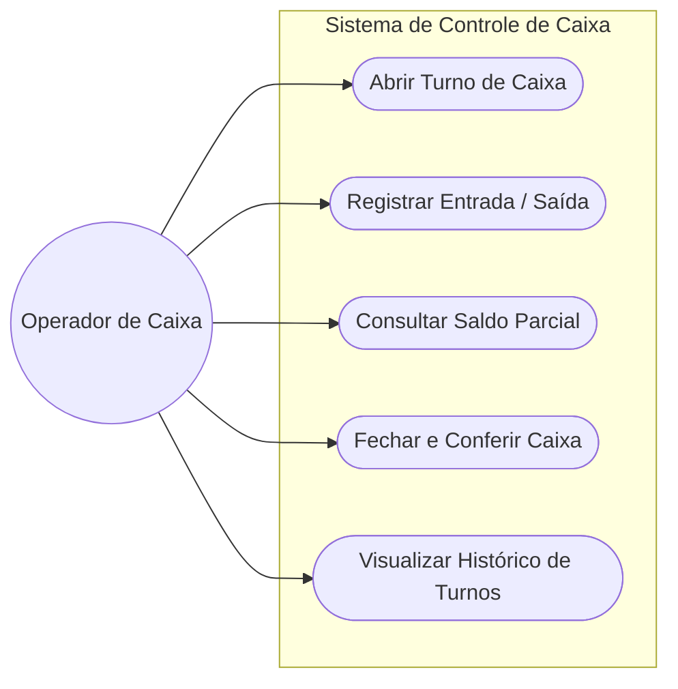
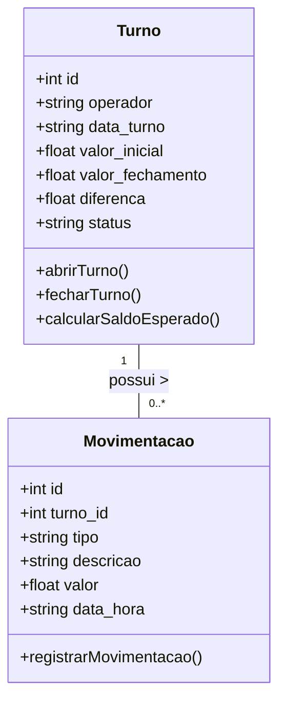

# Documentação Técnica — Sistema de Controle de Fechamento de Caixa (PIT II)

**Aluno:** Elysson Pessoa dos Reis  
**RGM:** 37110209  
**Curso:** Engenharia de Software  

---

## 1. Visão Geral e Revisão de Escopo (Kaizen)
Na etapa anterior (PIT I), foi definida a estrutura conceitual e a modelagem inicial orientada a objetos utilizando UML. Nesta etapa (PIT II), aplicando o princípio de melhoria contínua (*Kaizen*), o escopo foi refinado e direcionado para um MVP (Produto Mínimo Viável) funcional: um **Sistema Web de Controle de Turnos e Fechamento de Caixa**, voltado para pequenos comércios e postos de serviço, visando evitar divergências financeiras (quebra de caixa) e facilitar a conferência diária.

---

## 2. Levantamento de Requisitos

### Requisitos Funcionais (RF)
* **RF01 — Cadastro de Turno/Operador:** O sistema deve permitir iniciar um novo turno informando o nome do operador, a data e o valor inicial em caixa (fundo de troco).
* **RF02 — Registro de Movimentações:** O sistema deve permitir lançar entradas (vendas em dinheiro, PIX, cartão) e saídas (sangrias, despesas) vinculadas ao turno ativo.
* **RF03 — Cálculo Automático de Saldo:** O sistema deve calcular automaticamente o saldo esperado em caixa (`Valor Inicial + Entradas - Saídas`).
* **RF04 — Fechamento e Conferência:** O sistema deve permitir encerrar o turno informando o valor físico contado, apontando imediatamente se o caixa fechou correto, com sobra ou com quebra (falta).
* **RF05 — Histórico de Turnos:** O sistema deve listar todos os turnos registrados com seus respectivos status e saldos.

### Requisitos Não Funcionais (RNF)
* **RNF01 — Arquitetura:** O sistema deve ser desenvolvido seguindo o padrão arquitetural **MVC (Model-View-Controller)**.
* **RNF02 — Usabilidade (IHC):** Interface limpa, responsiva e intuitiva, com mensagens claras de confirmação e alerta de erro para campos obrigatórios.
* **RNF03 — Persistência de Dados:** Os dados devem ser armazenados em banco de dados relacional (SQLite) com integridade referencial.
* **RNF04 — Disponibilidade:** A aplicação deve estar hospedada em nuvem para acesso via navegador web.

---

## 3. Modelagem UML Atualizada

### 3.1 Diagrama de Casos de Uso


### 3.2 Diagrama de Classes


---

## 4. Projeto de Banco de Dados

### 4.1 Projeto Físico (Script SQL — SQLite)
```sql
CREATE TABLE turnos (
    id INTEGER PRIMARY KEY AUTOINCREMENT,
    operador TEXT NOT NULL,
    data_turno TEXT NOT NULL,
    valor_inicial REAL NOT NULL DEFAULT 0,
    valor_fechamento REAL,
    diferenca REAL,
    status TEXT NOT NULL DEFAULT 'ABERTO'
);

CREATE TABLE movimentacoes (
    id INTEGER PRIMARY KEY AUTOINCREMENT,
    turno_id INTEGER NOT NULL,
    tipo TEXT NOT NULL CHECK (tipo IN ('ENTRADA', 'SAIDA')),
    descricao TEXT NOT NULL,
    valor REAL NOT NULL,
    data_hora DATETIME DEFAULT CURRENT_TIMESTAMP,
    FOREIGN KEY (turno_id) REFERENCES turnos(id) ON DELETE CASCADE
);
```

### 4.2 Dicionário de Dados

**Tabela: `turnos`**
| Campo | Tipo | Restrição | Descrição |
| :--- | :--- | :--- | :--- |
| `id` | INTEGER | PK, AUTOINCREMENT | Identificador único do turno |
| `operador` | TEXT | NOT NULL | Nome do funcionário responsável pelo caixa |
| `data_turno` | TEXT | NOT NULL | Data de referência do turno |
| `valor_inicial` | REAL | NOT NULL | Valor de abertura (fundo de troco) |
| `valor_fechamento` | REAL | NULL | Valor físico contado no encerramento |
| `diferenca` | REAL | NULL | Diferença entre valor contado e saldo esperado |
| `status` | TEXT | NOT NULL | Situação atual (`ABERTO` ou `FECHADO`) |

**Tabela: `movimentacoes`**
| Campo | Tipo | Restrição | Descrição |
| :--- | :--- | :--- | :--- |
| `id` | INTEGER | PK, AUTOINCREMENT | Identificador único da movimentação |
| `turno_id` | INTEGER | FK (`turnos.id`) | Vínculo com o turno correspondente |
| `tipo` | TEXT | NOT NULL | Tipo de operação (`ENTRADA` ou `SAIDA`) |
| `descricao` | TEXT | NOT NULL | Motivo ou origem do lançamento |
| `valor` | REAL | NOT NULL | Valor monetário da operação |
| `data_hora` | DATETIME | DEFAULT NOW | Data e hora exata do registro |
